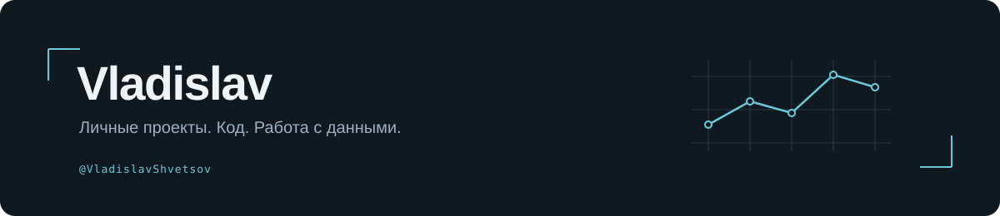

  <picture>
    <source media="(prefers-color-scheme: light)" srcset="assets/profile-light.svg" />
    
  </picture>

  
<strong>Привет, я Владислав.</strong> 
  Здесь собираю личные проекты, эксперименты с кодом и учебные работы.

  

    
    
  

  

    <a href="https://github.com/VladislavShvetsov?tab=repositories">Все репозитории</a>
    &nbsp; · &nbsp; <a href="https://github.com/VladislavShvetsov?tab=stars">Избранное</a>
  

## Проекты

<table>
  <tr>
    <td width="50%" valign="top">
      <h3><a href="https://github.com/VladislavShvetsov/hidemykeys">hidemykeys</a></h3>
      
Небольшой скрипт на Python.

      
Python · скрипты

    </td>
    <td width="50%" valign="top">
      <h3><a href="https://github.com/VladislavShvetsov/yandex_praktikum">yandex_praktikum</a></h3>
      
Учебные работы и эксперименты с данными в Jupyter Notebook.

      
Python · Jupyter Notebook

    </td>
  </tr>
</table>

## Что здесь можно найти

- **Практические инструменты.** Небольшие проекты и скрипты для конкретных задач.
- **Работу с данными.** Ноутбуки, исследования и учебные решения.
- **Процесс обучения.** Код, к которому можно вернуться, разобраться в подходе и улучшить его.

---

От небольшой идеи — к работающему решению.

